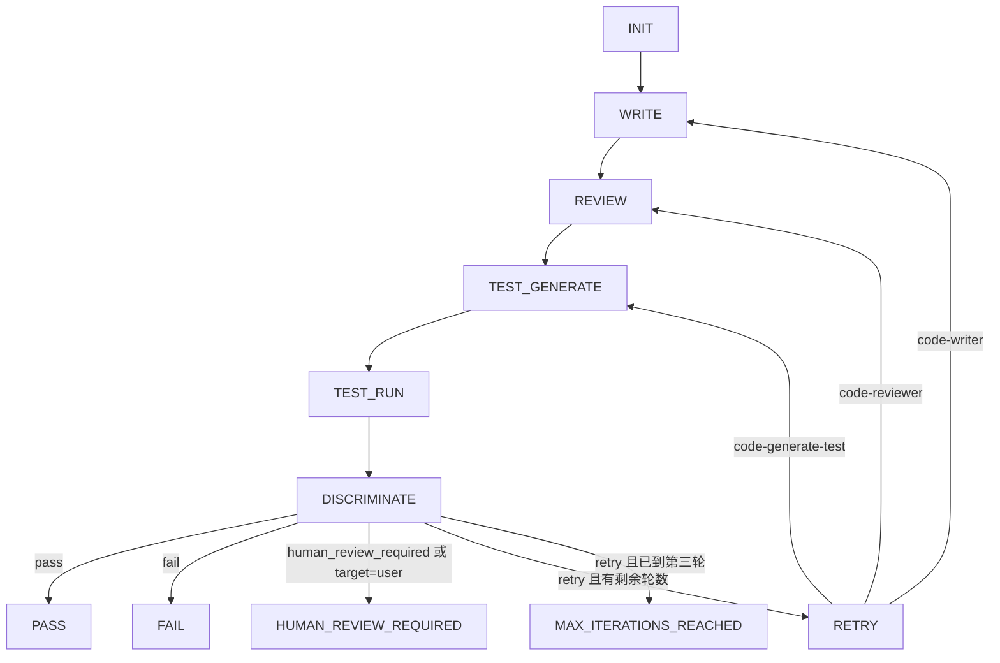

# ZCode Loop Engine

由 ZCode 宿主解释执行的 **writer → reviewer → test-generator → test-run → discriminator** 工作流配置。它把实现、独立审查、测试生成、测试证据和质量判定分开，面向有明确验收标准的代码任务。

## 定位与亮点

- 四个职责明确的 Agent，以及一个命令和主 Skill，可安装到 ZCode 配置目录。
- 最多三轮；可定向重试实现、审查或测试生成，而不是把所有问题交给 writer。
- 明确区分单轮 verdict 与工作流最终状态，诚实报告测试未运行或失败。
- 默认评分门槛允许有记录的证据例外，但不能豁免阻断缺陷或高风险未决事项。
- Memory 仅 proposal，必须经主会话展示及用户明确确认才写入。
- 无第三方 Python 依赖的内容校验、单测和 GitHub Actions 验证配置。

## 状态机



每次 retry 消耗下一轮；从对应阶段重新开始后，必须执行后续全部阶段。单轮 `overall_status` 为 `pass/retry/human_review_required/fail`；工作流 `final_status` 为 `pass/human_review_required/fail/max_iterations_reached`。`retry` 不是最终状态。

## 快速开始

1. 将仓库下载或克隆到本地，并进入仓库根目录。
2. 执行下方对应系统的安装命令；不需要安装 Python 包。
3. 在支持自定义 Agent、命令和 Skill 的 ZCode 宿主中刷新配置或重新开启会话。
4. 在待修改项目中输入明确任务，例如：

```text
/loop-engine 修复空输入处理，并补充能够复现旧缺陷的回归测试；保持现有接口兼容。
```

## 安装

PowerShell：

```powershell
powershell -NoProfile -File scripts/install.ps1
# 仅在确认覆盖现有配置后使用
powershell -NoProfile -File scripts/install.ps1 -Force
```

Shell（Bash）：

```bash
bash scripts/install.sh
# 仅在确认覆盖现有配置后使用
bash scripts/install.sh --force
```

脚本只安装四个 Agent、一个命令和主 Skill，共 6 个白名单文件。默认先检查全部冲突，遇到任何已存在目标文件就报错且不复制；覆盖必须显式启用，并通过同级临时文件替换目录项，避免写穿硬链接。拒绝源/目标路径重叠及 symlink/reparse 目标。脚本不执行网络请求，不删除用户文件（仅清理自身临时文件），不安装 Memory，不覆盖用户全局指令。具体路径、手动安装及宿主前提见[安装说明](docs/installation.md)。

## 使用

宿主先读取项目规则与验收标准，再按[完整协议](zcode/skills/loop-engine/SKILL.md)组织四个独立角色。任一 Agent 不可用时应停止并说明，不得由同一角色静默兼任。TEST_RUN 由主会话调用已确认的项目测试命令，不是第五个 Agent。

- [基本流程](examples/basic-flow.md)
- [定向重试 reviewer](examples/retry-reviewer.md)
- [测试未运行](examples/tests-not-run.md)
- [需要人工决策](examples/human-review-required.md)

可选 companion skills `code-review`、`test-guide`、`discriminator-rubric` **不随仓库捆绑，也不是硬 import**。缺少它们时，以本仓库角色定义和主 Skill 为基准继续；不得假装调用了不存在的能力。

## 项目结构

```text
zcode/
  AGENTS.example.md          可人工合并的指令示例
  agents/                   四个角色定义
  commands/loop-engine.md   命令入口
  skills/loop-engine/        主 Skill
  loop/memory/              四个空模板，不自动安装
schemas/                    四类角色输出契约
scripts/                    安装及内容校验
tests/                      unittest 测试
docs/                       架构、安装、定制、Memory 与隐私
examples/                   完全虚构的结构化流程样例
.github/workflows/          内容验证 CI
```

相关说明：[架构](docs/architecture.md)、[定制](docs/customization.md)、[Memory 政策](docs/memory-policy.md)、[贡献指南](CONTRIBUTING.md)。

## 验证方式

在仓库根目录使用 Python 3.12 或更高版本：

```bash
PYTHONDONTWRITEBYTECODE=1 python scripts/validate_content.py --root .
PYTHONDONTWRITEBYTECODE=1 python -m unittest discover -s tests
```

PowerShell 使用以下等价命令：

```powershell
$env:PYTHONDONTWRITEBYTECODE = '1'
python scripts/validate_content.py --root .
python -m unittest discover -s tests
python scripts/validate_content.py --root .
```

校验器也可以从任意工作目录通过脚本路径运行；未提供 `--root` 时使用脚本所属仓库。所有发布文本都接受敏感内容扫描，包括 validator 与 test 源码，不设文件扫描豁免。它检查完整示例 envelope、契约及语义 probe、Markdown 链接与代码块、固定空 Memory 模板及 approval 规则，并拒绝任何 `__pycache__` 或 `.pyc`。它只实现本仓库 Schema 使用的标准库校验子集，不是通用 JSON Schema 工具，也不是秘密扫描或宿主执行行为的安全证明。CI 在 Linux 与 Windows 的 Python 3.12 上运行校验与单测，并在测试后再次校验；不执行业务项目工作流。

## 能力边界

这不是自带调度器、数据库、沙箱或 CI 的独立运行时，不提供后台服务、任务队列、持久会话、隔离执行或自动恢复。仓库附带的 GitHub Actions 只用于验证此仓库，不等于 Loop Engine 的业务执行器。

角色隔离是宿主需落实的 **policy**，不是单个 Skill 能提供的技术保证。Schema 描述输出形状，宿主仍须核查实际 diff、测试证据、状态转移和工具权限。评分是辅助证据，不能替代人工审批或安全边界。ZCode 的具体版本、资源发现与模型选择由使用者的宿主配置决定，本仓库不绑定模型。

## 隐私安全

仅发布人工编写的配置、空 Memory 模板及完全虚构示例，不收集遥测，不包含凭据、运行记录或本机私有配置。使用时宿主可能将代码、diff 和测试信息发送给其配置的模型服务；用户需审核宿主隐私策略、权限与项目授权。不要上传真实 Memory、日志、会话记录、密钥或内部业务上下文。详见[隐私说明](docs/privacy.md)及[安全报告流程](SECURITY.md)。

## License

本仓库采用 [MIT License](LICENSE)，Copyright (c) 2026 Loop Engine Contributors。可选外部 Skill 不属于本仓库授权范围。
